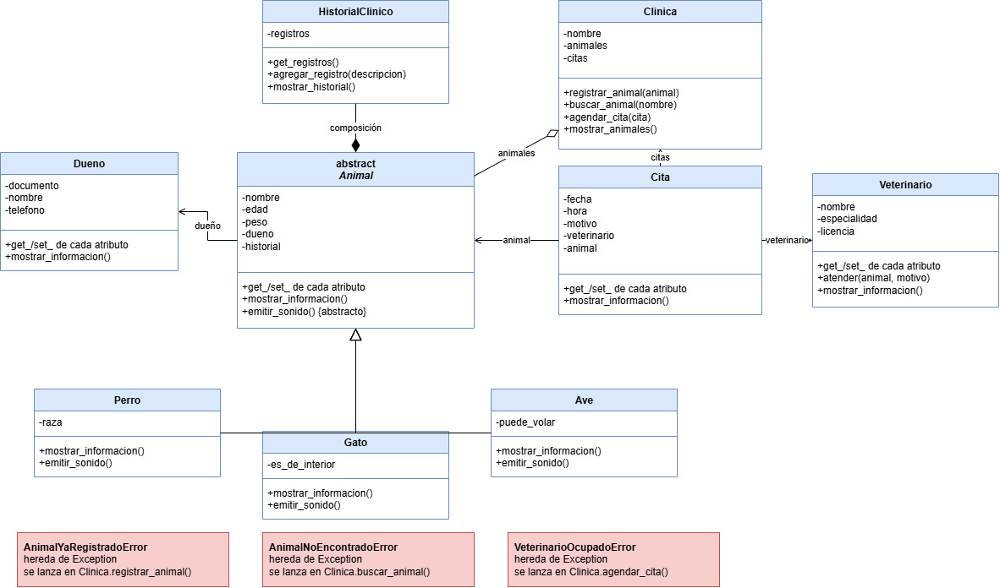

# Sistema de gestión de una clínica veterinaria

Proyecto en Python, orientado a objetos, que administra los animales de una clínica veterinaria, sus dueños, los veterinarios que los atienden y las citas que se agendan. Permite registrar animales de distintos tipos (perros, gatos y aves), llevar el historial clínico de cada uno y controlar situaciones anormales con excepciones propias.

## Integrantes

- Santiago Palacio Castañeda

## Problema que resuelve

Una clínica veterinaria necesita saber qué animales atiende, de quién son, qué tratamientos ha recibido cada uno y qué veterinario tiene citas en cada horario. Este sistema organiza esa información y evita errores comunes, como registrar dos veces el mismo animal o agendar a un veterinario en dos citas a la misma hora.

## Clases del sistema

| Clase | Responsabilidad |
|---|---|
| `Animal` (abstracta) | Datos generales de un animal: nombre, edad, peso, dueño e historial clínico. Define el método abstracto `emitir_sonido()` |
| `Perro`, `Gato`, `Ave` | Tipos de animal. Cada uno agrega su dato propio (`raza`, `es_de_interior`, `puede_volar`) y su propio comportamiento |
| `Dueno` | Persona dueña de un animal: documento, nombre y teléfono |
| `Veterinario` | Profesional que atiende animales: nombre, especialidad y licencia. Su método `atender()` agrega un registro al historial |
| `HistorialClinico` | Lista de registros médicos de un animal |
| `Cita` | Cita entre un veterinario y un animal, con fecha, hora y motivo |
| `Clinica` | Guarda los animales registrados y las citas agendadas, y controla los errores con excepciones |

Todos los atributos son privados (encapsulamiento). Se consultan con métodos `get_...` y se modifican con métodos `set_...`, que validan el valor y lanzan un `ValueError` si no es válido.

## Diagrama de clases



## Estructura de los archivos

```
Clinica_Veterinaria/
├── main.py                # Programa principal: casos normales y excepcionales
├── animal.py              # Clase abstracta Animal
├── perro.py               # Clase Perro (hereda de Animal)
├── gato.py                # Clase Gato (hereda de Animal)
├── ave.py                 # Clase Ave (hereda de Animal)
├── dueno.py               # Clase Dueno
├── veterinario.py         # Clase Veterinario
├── historial_clinico.py   # Clase HistorialClinico
├── cita.py                # Clase Cita
├── clinica.py             # Clase Clinica
├── excepciones.py         # Excepciones personalizadas
├── docs/
│   └── diagrama_de_clases.jpg
└── README.md
```

## Instrucciones para ejecutar el proyecto

1. Instalar [Python 3](https://www.python.org/downloads/) (el proyecto no usa librerías externas).
2. Clonar el repositorio:
   ```
   git clone https://github.com/santiagopalacio99-sys/Clinica_Veterinaria.git
   ```
3. Entrar a la carpeta del proyecto:
   ```
   cd Clinica_Veterinaria
   ```
4. Ejecutar el archivo principal:
   ```
   python main.py
   ```

## Clase abstracta

`Animal` hereda de `ABC` y su método `emitir_sonido()` tiene el decorador `@abstractmethod`. Un animal "genérico" no existe en la clínica: siempre es un perro, un gato o un ave, y cada tipo hace un sonido distinto. Por eso Python impide crear objetos de `Animal` directamente y lanza un `TypeError`. `main.py` lo demuestra con una prueba.

## Herencia

`Perro`, `Gato` y `Ave` heredan de `Animal`, porque un perro **es un** animal, un gato **es un** animal y un ave **es un** animal.

- **Comparten** (heredados de `Animal`): nombre, edad, peso, dueño, historial clínico, sus métodos `get_` y `set_`, y `mostrar_informacion()`.
- **Propios de cada una:** `Perro` guarda la `raza`, `Gato` guarda `es_de_interior` y `Ave` guarda `puede_volar`.

Cada hija llama a `super().__init__(...)` para que `Animal` guarde los datos generales y solo agrega lo suyo.

## Sobreescritura

Las tres hijas sobrescriben dos métodos de `Animal`, con el mismo nombre y un resultado distinto según el tipo:

- `emitir_sonido()`: el perro ladra (*¡Guau guau!*), el gato maúlla (*¡Miau!*) y el ave canta (*¡Pío pío!*).
- `mostrar_informacion()`: cada una llama primero a `super().mostrar_informacion()` y luego muestra su dato propio (la raza, si vive solo en interiores o si puede volar).

## Polimorfismo

`Clinica` guarda en una sola lista perros, gatos y aves. En `main.py` esa lista se recorre con un único ciclo `for`, que llama a `mostrar_informacion()` y a `emitir_sonido()` sobre todos los objetos sin usar condicionales para decidir qué hacer según el tipo. Python ejecuta automáticamente la versión que corresponde a la clase real de cada animal.

```python
for animal in clinica.get_animales():
    animal.mostrar_informacion()
    animal.emitir_sonido()
```

## Composición

`Animal` **contiene** un objeto `HistorialClinico`, que crea dentro de su propio constructor (`self._historial = HistorialClinico()`). No llega como dato desde afuera, y por eso `Animal` no tiene un método `set_historial`.

**Por qué es composición:** el historial forma parte esencial del animal. Nace cuando el animal llega a la clínica, describe únicamente a ese animal y no tiene sentido por sí solo: si el animal desaparece del sistema, su historial desaparece con él.

**Por qué no es herencia:** un animal no *es un* historial clínico, ni un historial *es un* animal. La relación correcta es "un animal **tiene un** historial". Si se resolviera con herencia, el animal recibiría los atributos y métodos de un historial sin necesitarlos, y el diseño sería confuso. Con composición, cada clase tiene una sola responsabilidad: `HistorialClinico` solo guarda y muestra registros, y `Animal` se ocupa de los datos del animal.

## Relaciones entre objetos

- `Animal` guarda un objeto `Dueno`.
- `Cita` guarda un objeto `Veterinario` y un objeto `Animal`.
- `Clinica` guarda listas de objetos `Animal` y `Cita`.

En todos los casos se guardan objetos y no solo nombres o códigos como textos.

## Excepciones personalizadas

Están definidas en `excepciones.py`, como clases que heredan de `Exception`. Cada una se lanza con `raise` desde el método responsable y se captura en `main.py` con `try` / `except`, mostrando un mensaje claro. El programa continúa su ejecución después de controlarlas.

| Excepción | Situación que controla | Dónde se lanza |
|---|---|---|
| `AnimalYaRegistradoError` | Se intenta registrar un animal que ya está registrado | `Clinica.registrar_animal()` |
| `AnimalNoEncontradoError` | Se busca un animal que no está registrado | `Clinica.buscar_animal()` |
| `VeterinarioOcupadoError` | El veterinario ya tiene una cita a la misma fecha y hora | `Clinica.agendar_cita()` |

## Qué demuestra `main.py`

1. La creación de 10 objetos: 3 dueños, 5 animales y 2 veterinarios.
2. El registro de animales en la clínica.
3. El recorrido polimórfico de la lista de animales.
4. La composición: el historial clínico de cada animal se llena con `Veterinario.atender()`.
5. El agendamiento de citas.
6. La búsqueda de un animal que existe.
7. Que no se puede crear un `Animal` directamente.
8. Un intento de valor inválido (edad negativa).
9. Las tres excepciones personalizadas, cada una capturada con el programa continuando su ejecución.

## Uso de herramientas de inteligencia artificial

Se utilizó Claude (Anthropic) como apoyo y tutor en esta actividad. Su uso consistió en:

Uso de herramientas de inteligencia artificial
Se utilizó Claude (Anthropic) como apoyo y tutor en esta actividad. Su uso consistió en:

- Proponer ideas iniciales para el contexto del proyecto y servir como apoyo para evaluar alternativas de diseño de clases y relaciones entre objetos.
- Resolver dudas conceptuales relacionadas con clases abstractas, herencia, sobreescritura, polimorfismo, composición y excepciones personalizadas.
- Brindar ejemplos y orientación sobre posibles implementaciones, así como apoyo en la elaboración de documentación técnica.
- Orientar el proceso de creación del repositorio, ejecución de pruebas y gestión de versiones mediante Git y GitHub.